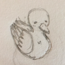
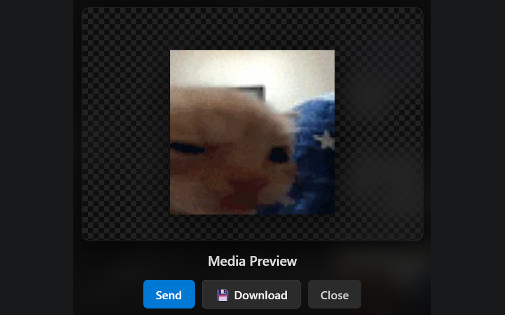

# Messenger Media Manager

### Custom Stickers, GIFs, & Media Manager for Facebook and Messenger

 

[**Report an Issue**](https://github.com/Oxazite/messenger-media-manager/issues)

---

## 📸 Previews

  
  
<em>Embedded media drawer directly inside Messenger with custom categories & search</em>

   
  
  
<em>Category organization, favorites, and quick media filtering</em>

   
  
  
<em>Multi-select and bulk actions for seamless media vault management</em>

---

## ✨ Features

- **Custom Stickers on PC**: Send images, animated GIFs, and videos directly as native stickers into chat.
- **One-Click Media Save**: Right-click any image, GIF, or video across Messenger to save it instantly to your personal media vault.
- **Sticker Editor**: Add clean white outlines, soft gradient glow outlines, or flip stickers horizontally with a single click.
- **Convert Video to GIF**: Convert video files or existing video stickers directly into lightweight animated GIFs.
- **Voice Note Downloader**: Download voice messages directly from chat as lossless 16-bit PCM WAV audio files.
- **One-Way Stealth Mode**: Conceal outbound typing indicators and read receipts permanently without sacrificing incoming message status.
- **Fast Organization**: Custom categories, instant search tags, favorites, and full ZIP backup/restore.
- **100% Private & Local**: All media and settings remain strictly on your local device.

---

## 🆕 What's New in v1.2.0

- **Gradient Outline & Aesthetic Styling**: Soft radial gradient outline support alongside classic white outlines, with clean 16px outline stripping.
- **In-Chat Video-to-GIF Conversion**: Right-click any existing video sticker to convert it directly to an animated GIF.
- **Streamlined Media Processing**: Clean, distraction-free conversion progress dialog.
- **Performance & Reliability Hardening**: Zero-IPC large file downloads, hardware audio decoding lifecycle cleanup, and instant cross-tab metadata synchronization.

---

## 📄 License & Disclaimer

© 2026 Oxazite. All rights reserved.

This repository is for showcase and issue tracking purposes only. The underlying source code, algorithms, and binary distributions are proprietary and protected under copyright law. Unauthorized copying, distribution, modification, or reverse engineering is strictly prohibited.

> **Disclaimer:** Messenger Media Manager is an independent project and is not affiliated with, sponsored by, or endorsed by Meta Platforms, Inc. or Facebook.
