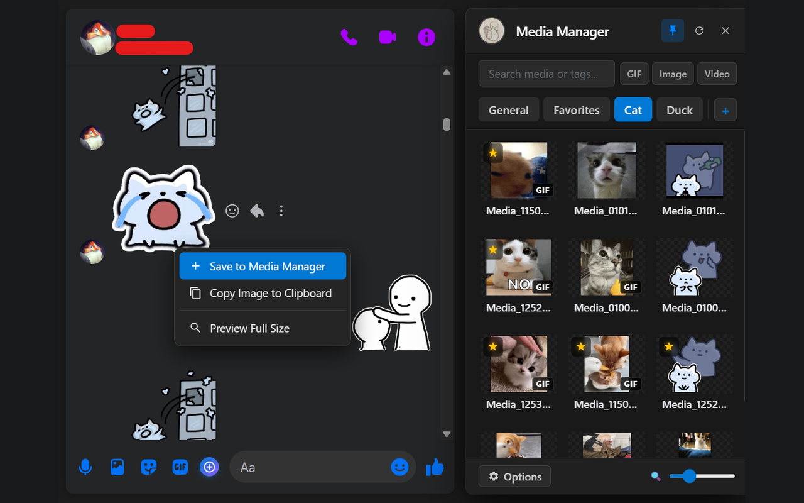
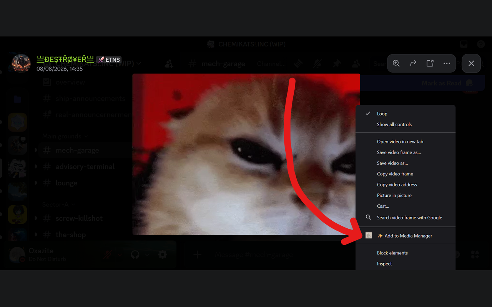



# Messenger Media Manager

### The Ultimate Custom Stickers, GIFs, & Media Manager for Facebook Messenger

 

[**Install from Chrome Web Store**](https://chromewebstore.google.com/detail/adejogjpndbddbpcanefdkgdajmaaekb?authuser=0&hl=en) • [**Report an Issue**](https://github.com/Oxazite/messenger-media-manager/issues)

---

## 📸 Preview

  
    
  

---

## ✨ Features

- **True Stickers**: Native borderless stickers visible on all platforms.
- **Flexible Sending**: Instant 1-click send or attachment staging.
- **Fast & Smooth**: Virtual scrolling with zero frame drops.
- **100% Local**: No external servers, analytics, or tracking.
- **Universal**: Runs on all Chromium browsers.

---

## 📥 Installation

Install directly from the official **Chrome Web Store** with 1 click:

👉 **[Get Messenger Media Manager on Chrome Web Store](https://chromewebstore.google.com/detail/adejogjpndbddbpcanefdkgdajmaaekb?authuser=0&hl=en)**

---

## 📄 License & Copyright

© 2026 Oxazite. All rights reserved.

This repository is for showcase and issue tracking purposes only. The underlying source code, algorithms, and binary distributions are proprietary and protected under copyright law. Unauthorized copying, distribution, modification, or reverse engineering is strictly prohibited.
