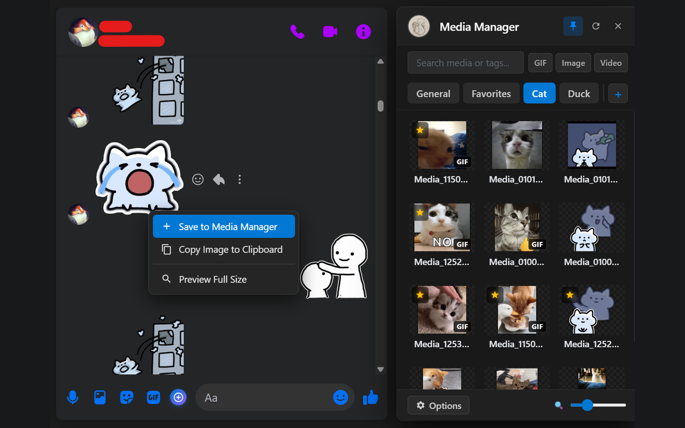
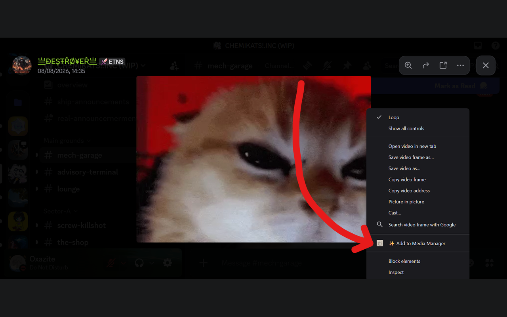
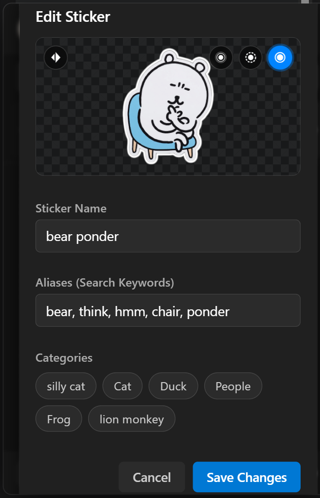

# Messenger Media Manager

### Custom Stickers, GIFs, & Media Manager for Messenger and Facebook

 

[**Report an Issue**](https://github.com/Oxazite/messenger-media-manager/issues)

---

## 📸 Previews

  
  
<em>Custom sticker drawer inside Messenger with search, filters, categories, and quick save</em>

   
  
  
<em>Right-click any image, GIF, or video on the web to add it to your collection</em>

   
  
  
<em>Full-size preview modal to send or download any saved item</em>

   
  
  
<em>Built-in sticker editor with flip, outline styles, search keywords, and categories</em>

---

## ✨ Features

- **Save anything from anywhere**: Right-click any image, GIF, or video on the web, drag and drop files, or save straight from Messenger chats.
- **Your own sticker drawer**: Open your collection right in the chat bar, search instantly, filter by GIF/Image/Video, and organize favorites into custom tabs.
- **Easy built-in editor**: Crop & zoom, flip, add or remove white and gradient sticker outlines, and trim video clips before sending.
- **Extra chat perks**: Download voice messages and hide your Read or Typing status globally or per person.
- **100% private**: Everything stays on your device with easy backup and restore—no account or tracking.

---

## 🆕 What's New in v2.0.0

- **In-Page Crop & Video Trimmer**: Adjust sticker framing and trim video clips right inside the preview window.
- **Outline & Flip Styles**: Toggle white or gradient sticker outlines and flip stickers horizontally in one click.
- **Custom Read & Typing Privacy**: Hide or allow Read Receipts and Typing Status per conversation or for everyone.
- **Faster & More Reliable Backups**: Smooth full-library backup export/import, bulk actions, and instant multi-tab sync.

---

## 📄 License & Disclaimer

© 2026 Oxazite. All rights reserved.

This repository is for showcase and issue tracking purposes only. The underlying source code, algorithms, and binary distributions are proprietary and protected under copyright law. Unauthorized copying, distribution, modification, or reverse engineering is strictly prohibited.

> **Disclaimer:** Messenger Media Manager is an independent project and is not affiliated with, sponsored by, or endorsed by Meta Platforms, Inc. or Facebook.
