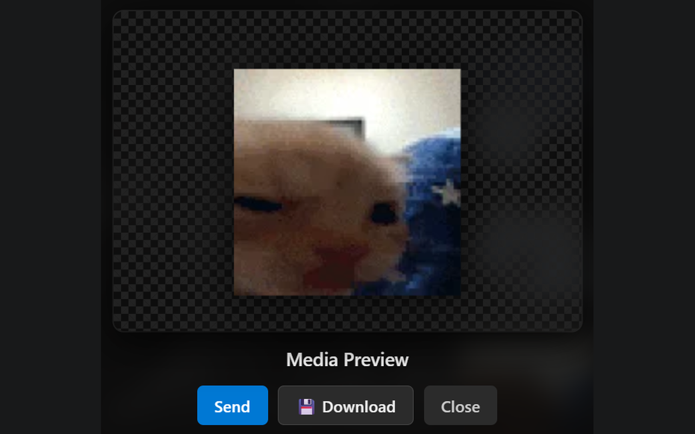

# Messenger Media Manager

### The Ultimate Custom Stickers, GIFs, & Media Manager for Facebook Messenger

 

[**Install from Chrome Web Store**](https://chromewebstore.google.com/detail/adejogjpndbddbpcanefdkgdajmaaekb?authuser=0&hl=en) • [**Report an Issue**](https://github.com/Oxazite/messenger-media-manager/issues)

---

## 📸 Previews

  
  
<em>Embedded Media Drawer directly inside Messenger with custom categories & search</em>

   
  
  
<em>Category organization, favorites, and quick media filtering</em>

   
  
  
<em>Multi-select and bulk actions for seamless vault management</em>

---

## ✨ Features

- **🚀 True Native Stickers**: Dispatches custom media as native, borderless stickers visible across Web, iOS, and Android.
- **🔒 Full E2EE Secret Chat Support**: Seamlessly send custom borderless stickers in End-to-End Encrypted conversations.
- **⚡ Hardware-Accelerated WebCodecs**: Powered by an isolated Chromium Offscreen Document and native `ImageDecoder` for smooth 390+ frame animations with zero UI lag.
- **🎨 Adaptive Quality Compression**: Preserves 100% native resolution and full frame counts while dynamically keeping payloads under platform upload ceilings.
- **🎭 Dual Send Modes**: Instant 1-click dispatch or attachment staging with live preview before sending.
- **📦 Multi-Select & Bulk Operations**: Select multiple items for batch categorization, starring, deleting, and ZIP export.
- **⌨️ Keyboard Navigation**: Fast arrow-key navigation with instant Enter-to-send support.
- **🛡️ 100% Local & Private**: All media stays strictly inside your browser storage (`chrome.storage.local`). Zero external servers, analytics, or telemetry.
- **🌐 Universal Chromium Support**: Seamlessly runs on Chrome, Brave, Edge, Opera, Arc, and other Chromium browsers.

---

## 🆕 What's New in v1.1.0

- **End-to-End Encryption (E2EE) Optimization**: Native WebP sticker delivery in encrypted chats with adaptive compression.
- **High-Performance Offscreen Pipeline**: Media encoding and decoding run off the main thread, keeping chat interactions fluid at 60 FPS.
- **Enhanced Keyboard Navigation**: Intuitive category and grid navigation via keyboard.
- **Multi-Select & Vault Backups**: Complete vault export and restore in one click.

---

## 📥 Installation

Install directly from the official **Chrome Web Store** with 1 click:

👉 **[Get Messenger Media Manager on Chrome Web Store](https://chromewebstore.google.com/detail/adejogjpndbddbpcanefdkgdajmaaekb?authuser=0&hl=en)**

---

## 📄 License & Copyright

© 2026 Oxazite. All rights reserved.

This repository is for showcase and issue tracking purposes only. The underlying source code, algorithms, and binary distributions are proprietary and protected under copyright law. Unauthorized copying, distribution, modification, or reverse engineering is strictly prohibited.
